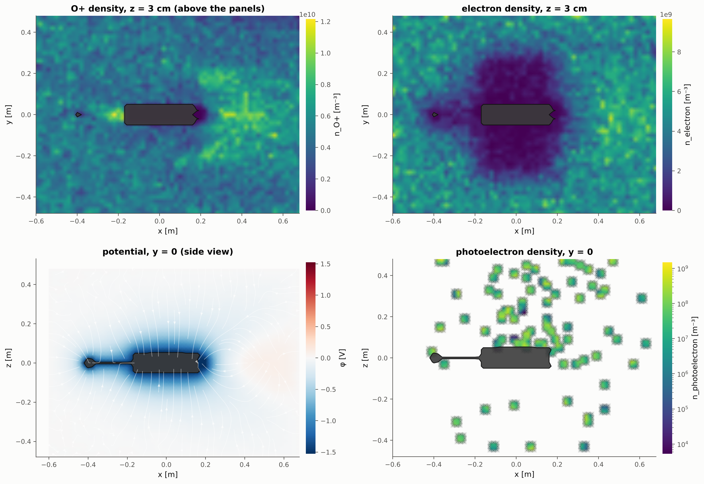
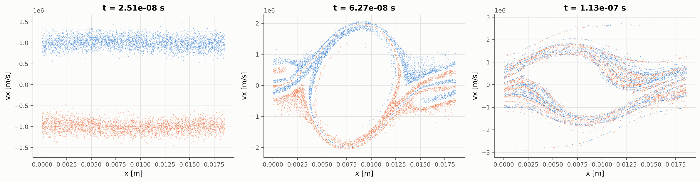

<p align="center">
  
</p>

# PICSP3D: parallel 3D3V electrostatic particle-in-cell code

PICSP3D is the three-dimensional successor of the original 2D PICSP code (kept in [`legacy/`](legacy)).
It is an MPI + OpenMP parallel, electrostatic particle-in-cell code for plasma-object interaction:
spacecraft and probe charging, sheaths and wakes, dust grains, electrodes and plasma devices with
embedded objects of arbitrary shape, background magnetic fields and surface emission processes.

| | |
|---|---|
| **Model** | 3D3V electrostatic PIC, any number of species, SI units throughout |
| **Field solver** | Poisson on a uniform node grid, geometric multigrid preconditioned CG (BiCGStab fallback), 2nd order with 3rd-order cut-cell boundaries |
| **Particle push** | Boris scheme with uniform background **B** and **E** (incl. motional E = -v x B), CIC or TSC shapes, species sub-cycling |
| **Objects** | analytic primitives, CSG (union / subtract / intersect), STL import (BVH, generalised winding numbers), thin sheets, rigid transforms |
| **Charging** | fixed (time-ramped) bias or floating conductors via the capacitance-matrix method, connected groups, external capacitance and current |
| **Surface physics** | absorption with per-panel current densities, Sternglass / constant SEE, ion-induced emission, photoemission with self-shadowing |
| **Boundaries** | per face: periodic, Dirichlet, Neumann (fields); periodic, absorbing, reflecting, open with flux injection (particles) |
| **Velocity sampling** | Maxwellian, drifting, bi-Maxwellian, kappa, ring, cold beams; random or quiet (Halton) loading, density perturbations |
| **Collisions** | Monte Carlo null-collision method: elastic and charge exchange with a neutral background |
| **Parallelism** | 3D Cartesian MPI domain decomposition, OpenMP threading, SoA particle storage, cell sorting |
| **Output** | parallel VTK (`.pvti`, `.pvtp`, `.pvd` time series) for ParaView, CSV history, bit-exact checkpoint / restart |
| **Post-processing** | `picsp_post` Python package: history panels, slices with streamlines, phase space, VDFs, 3D pyvista rendering, MP4/GIF animations |

<p align="center">
  <br>
  <em>3U CubeSat (STL bus + solar panels + boom + isolated probe) in a Mach-4 O+ flow: net surface current
  density (sunlit faces photoemit, shadowed faces collect electrons) and the ion wake with focusing downstream.</em>
</p>

## Building

Requirements: a C++20 compiler, CMake >= 3.18, MPI and OpenMP. No other libraries are needed
(the TOML parser is vendored in `extern/`).

```bash
sudo apt install build-essential cmake libopenmpi-dev openmpi-bin     # Debian / Ubuntu
cmake -S . -B build -DCMAKE_BUILD_TYPE=Release
cmake --build build -j
ctest --test-dir build --output-on-failure                           # verification suite
```

CMake options: `PICSP_NATIVE` (default `ON`, compile with `-march=native`), `PICSP_TESTS` (default `ON`).

Post-processing (Python >= 3.9):

```bash
pip install -e python            # numpy, matplotlib, pyvista, imageio[-ffmpeg]
```

## Running

```bash
cd examples
python3 geometry/make_cubesat_stl.py geometry/cubesat_3u.stl
export OMP_NUM_THREADS=4
mpirun -np 8 --map-by ppr:2:socket:pe=4 ../build/picsp3d cubesat_wake.toml
```

Command line: `picsp3d input.toml [--restart DIR] [--steps N] [--output DIR] [--check]`.
`--check` sets up the geometry, solver and particles and exits, which is a quick way to validate an input.

> **Thread binding.** Most MPI launchers pin each rank to a single core by default, which silently
> serialises the OpenMP threads. Give each rank as many cores as threads (`--map-by ...:pe=N` in
> Open MPI, `--cpus-per-task` in Slurm) or use `--bind-to none`. PICSP3D prints a warning when it
> detects fewer available cores than threads.

## A minimal input

```toml
title = "Floating sphere"

[grid]
cells = [64, 64, 64]
dx_debye = 0.25            # or dx = <metres>, or length = [Lx, Ly, Lz]
centered = true

[time]
dt_wpe = 0.1               # or dt = <seconds>
steps = 5000

[boundaries]
default = { field = "dirichlet", value = 0.0, particle = "open" }

[fields]
B0 = [0.0, 0.0, 2e-5]      # tesla

[[species]]
name = "electron"
charge = -1
mass_me = 1
density = 1e12
temperature = 1.0
ppc = 16

[[species]]
name = "H+"
charge = 1
mass_amu = 1.007
density = 1e12
temperature = 0.1
drift = [4e4, 0.0, 0.0]

[[objects]]
name = "sphere"
shape = "sphere"
radius = 0.01
bias = "floating"
see = { model = "sternglass", delta_max = 1.5, e_max = 300.0 }

[output]
dir = "output"
fields_every = 500
surface_every = 500
history_every = 10
```

The complete list of keys is in [`docs/input_reference.md`](docs/input_reference.md); the numerical
methods are described in [`docs/numerics.md`](docs/numerics.md).

## Examples

| File | Physics |
|---|---|
| [`langmuir.toml`](examples/langmuir.toml) | Langmuir oscillation, periodic box |
| [`two_stream.toml`](examples/two_stream.toml) | two-stream instability, phase-space vortices |
| [`sphere_oml.toml`](examples/sphere_oml.toml) | floating sphere, validation against orbit-motion-limited theory |
| [`langmuir_probe_sweep.toml`](examples/langmuir_probe_sweep.toml) | swept-bias spherical probe in a magnetised plasma, I-V curve |
| [`collisional_electrode.toml`](examples/collisional_electrode.toml) | biased electrode in argon with MCC elastic and charge-exchange collisions |
| [`cubesat_wake.toml`](examples/cubesat_wake.toml) | 3U CubeSat (STL + solar panels + boom + isolated probe) in mesothermal O+ flow with B, photo- and secondary emission |

Analysis scripts for the validation cases are in [`examples/analysis/`](examples/analysis).

## Output and post-processing

Each run directory contains

* `fields.pvd`: potential `phi`, charge density `rho`, electric field `E`, per-species density `n_<s>`,
  mean velocity `u_<s>` and temperature `T_<s>` (eV), object node ids and the signed distance `sdf`;
* `surface.pvd`: triangulated object surfaces with potential, sun incidence, and current densities
  `J_<species>`, `J_emit`, `J_net` (A/m², averaged over the accumulation interval);
* `particles.pvd`: sub-sampled macro-particles with velocity, energy, weight and species;
* `history.csv`: particle counts, kinetic / field / total energy, conductor potentials and charges,
  collected and emitted currents per object and species, wall losses, solver iterations;
* `checkpoint/`: restart files (one per rank).

The `.pvd` files open directly in ParaView as animations. With the Python package:

```bash
python -m picsp_post info      output
python -m picsp_post history   output                       # energies, potentials, currents
python -m picsp_post slice     output -f phi -a z --streamlines
python -m picsp_post slice     output -f n_O+ -a z --log
python -m picsp_post phase     output -s electron -x x -v vx
python -m picsp_post render    output --surface J_net --particles
python -m picsp_post animate   output -f n_electron -a y      # MP4 (or .gif with -o name.gif)
python -m picsp_post animate   output --scene --orbit         # 3D movie
```

or from Python:

```python
from picsp_post import Run, plots
run = Run("output")
phi = run.field_array(-1, "phi")          # numpy array (nx+1, ny+1, nz+1)
plots.plot_slice(run, "phi", axis="y", streamlines=True)
```

## Verification

The `ctest` suite runs every test serially and on 4 MPI ranks:

| Test | Result |
|---|---|
| Poisson, manufactured solutions (Dirichlet, periodic, Neumann) | 2nd-order convergence, 7 to 8 MG-PCG iterations to 1e-10 independent of grid size |
| Concentric-sphere capacitor (CSG cavity) | capacitance error 0.08% with cut cells (-4.6% staircase), potential error converges at 3rd order |
| Gyration in uniform B | gyro-frequency error 3e-5, speed conserved to round-off |
| E x B drift across ranks and periodic boundaries | 0.25% |
| Reflecting / absorbing walls | exact time of flight |
| Velocity samplers | Maxwellian, kappa (kurtosis), bi-Maxwellian moments within sampling error |
| MCC elastic and charge exchange | momentum relaxation exp(-nu t) within 1% |
| STL import | 0 sign errors on 20000 random points, winding numbers handle overlapping shells |
| Checkpoint / restart | bit-identical to an uninterrupted run |

Physics validation runs (in `examples/`):

| Case | Result |
|---|---|
| Langmuir oscillation | frequency and damping consistent with Bohm-Gross, energy conserved to 1e-4 |
| Two-stream instability | growth rate 0.481 ω_b vs 0.500 ω_b cold-beam theory |
| Floating sphere, R = λ_D/2 | V_f = -1.51 V vs OML -1.42 V; ion current within 3% of OML |

| | |
|---|---|
|  |  |
| CubeSat: ion and electron densities, potential with field lines, photoelectrons | two-stream instability: phase-space vortex formation |

## Code layout

```
src/
  config/      TOML input -> SI configuration
  parallel/    Cartesian MPI decomposition
  grid/        distributed node fields with ghost layers and halo exchange
  geometry/    signed-distance primitives, CSG, STL + BVH + winding numbers
  fields/      embedded boundary, multigrid Krylov Poisson solver, conductors, E field
  particles/   species, velocity samplers, Boris push, deposition, migration, injection, sorting
  objects/     surface panels, charging, secondary and photoemission
  collisions/  Monte Carlo collisions
  io/          parallel VTK writers
python/picsp_post   post-processing package
tests/              verification suite (ctest)
examples/           inputs, geometry generator, analysis scripts
legacy/             original 2D PICSP code
```

## Limitations and roadmap

* Electrostatic only; the magnetic field is static and uniform (spatially varying B and an
  electromagnetic solver are natural next steps; the field and particle interfaces are separated for that).
* Static domain decomposition (no dynamic load balancing yet).
* Objects must lie inside the domain on periodic axes (no periodic images of objects).
* Collision cross sections are constant; Coulomb collisions and ionisation are not yet included.

## License

See [LICENSE](LICENSE).
