<p align="center">
  <picture>
    <source media="(prefers-color-scheme: dark)" srcset="docs/logo/picsp3d_logo_on_dark.png">
    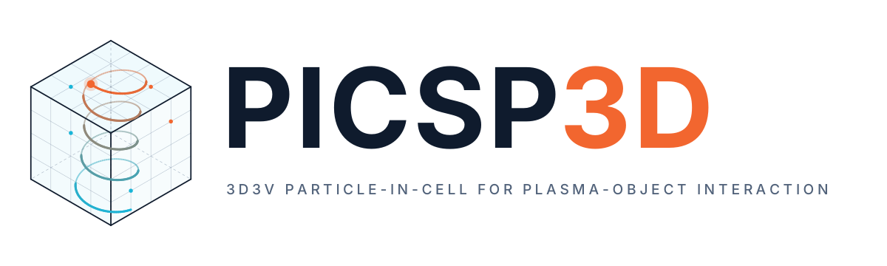
  </picture>
</p>

<p align="center">
  <a href="https://github.com/sayanadhikari/picsp/actions/workflows/ci.yml"></a>
</p>

<p align="center">
  <b>A parallel 3D3V electrostatic particle-in-cell code for plasma-object interaction</b><br>
  MPI + OpenMP &nbsp;·&nbsp; embedded objects from primitives and STL &nbsp;·&nbsp; floating-conductor charging &nbsp;·&nbsp;
  static and spatially varying B &nbsp;·&nbsp; Monte Carlo and Coulomb collisions &nbsp;·&nbsp; VTK output
</p>

<p align="center">
  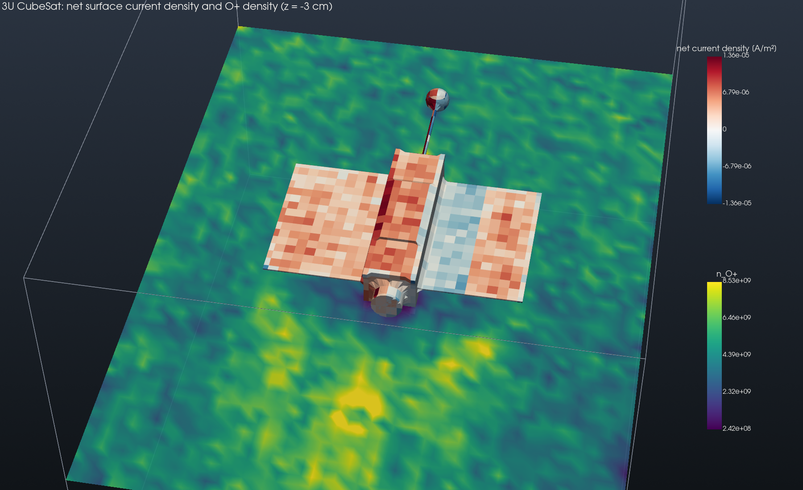<br>
  <em>A 3U CubeSat imported from STL, with solar panels, a boom and an electrically isolated probe, in a
  mesothermal O⁺ flow with a magnetic field. Sunlit faces photoemit, shadowed faces collect electrons, and an
  ion wake forms downstream.</em>
</p>

PICSP3D is the three-dimensional successor of the 2D code PICSP (the original is preserved on the
[`2d-legacy`](https://github.com/sayanadhikari/picsp/tree/2d-legacy) branch and in [`legacy/`](legacy)). It simulates collisionless and
collisional plasmas around objects of arbitrary shape: spacecraft and probe charging, sheaths and
wakes, Langmuir probes, dust grains, electrodes, magnetised plasma devices and gas discharges. The
code is written in C++20 with MPI domain decomposition, OpenMP threading and vectorisable
structure-of-arrays particle storage, and comes with a Python post-processing package for
publication-quality figures, animations and 3D renderings.

## Contents

* [Capabilities at a glance](#capabilities-at-a-glance)
* [Gallery](#gallery)
* [Building](#building)
* [Running](#running)
* [A complete input file](#a-complete-input-file)
* [Features in detail](#features-in-detail)
* [Feature examples](#feature-examples)
* [Output and post-processing](#output-and-post-processing)
* [Verification](#verification)
* [Performance notes](#performance-notes)
* [Code layout](#code-layout)
* [Limitations and roadmap](#limitations-and-roadmap)

## Capabilities at a glance

| Area | Capabilities |
|---|---|
| **Model** | 3D3V electrostatic PIC, any number of species, SI units throughout, test-particle mode |
| **Field solver** | Poisson on a uniform node grid; geometric multigrid preconditioned CG with BiCGStab fallback; second-order Shortley-Weller cut cells at object surfaces |
| **Magnetic fields** | uniform B0 plus any superposition of analytic sources: dipole, exact current loop, solenoid, magnetic mirror, straight wire |
| **Particle push** | Boris scheme with the local E and B per particle, motional field E = −v × B for moving frames, CIC or TSC shape functions, species sub-cycling |
| **Objects** | spheres, boxes, cylinders, cones, tori, ellipsoids, plates, half-spaces; CSG union / subtract / intersect; rigid transforms; STL import with units, anchor placement and rescaling, BVH and generalised winding numbers; `mesh` import tool; sub-cell thin sheets |
| **Charging** | fixed or time-ramped bias, floating conductors via the capacitance-matrix method, electrically connected groups, external capacitance and current |
| **Surface physics** | absorption with per-panel current densities; Sternglass or constant secondary electron emission; ion-induced emission; photoemission with self-shadowing by ray casting |
| **Boundaries** | per face: periodic, Dirichlet, Neumann for fields; periodic, absorbing, specular reflecting, open with one-sided flux injection for particles |
| **Velocity sampling** | Maxwellian, drifting, bi-Maxwellian along any axis, kappa, ring, cold beam; random or quiet (Halton) loading; density perturbations |
| **Neutral collisions** | Monte Carlo null-collision method: elastic, charge exchange, excitation, electron-impact ionisation (creates electron-ion pairs); constant, step, Lotz or tabulated cross sections |
| **Coulomb collisions** | binary Takizuka-Abe collisions within cells, intra- and inter-species, Nanbu-Yonemura weight correction, fixed or automatic Coulomb logarithm, sub-cycling |
| **Parallelism** | 3D Cartesian MPI decomposition, OpenMP threads, SoA particles, periodic cell sorting, thread-private deposition |
| **Output** | parallel VTK (`.pvti`, `.pvtp`, `.pvd` time series) for ParaView; CSV history with energies, temperatures, drifts, currents and potentials; particle trajectories; bit-exact checkpoint / restart |
| **Post-processing** | `picsp_post`: history panels, slices with field lines, phase space, distribution functions, off-screen 3D pyvista rendering, MP4 / GIF animations |

## Gallery

<table>
<tr>
<td width="50%">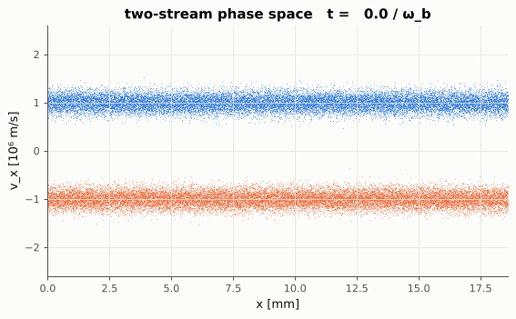<br><em>Two-stream instability: phase-space vortices form as the beams trap each other.</em></td>
<td width="50%">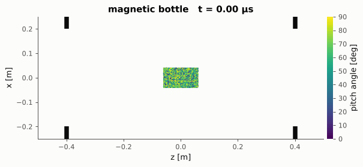<br><em>Electrons in a magnetic bottle made of two current loops: trapped particles bounce, the loss cone empties.</em></td>
</tr>
<tr>
<td>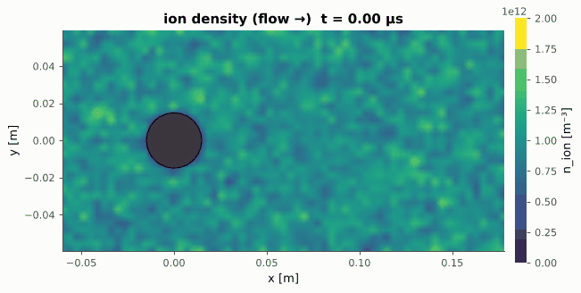<br><em>Ion wake behind a floating sphere in a mesothermal flow.</em></td>
<td>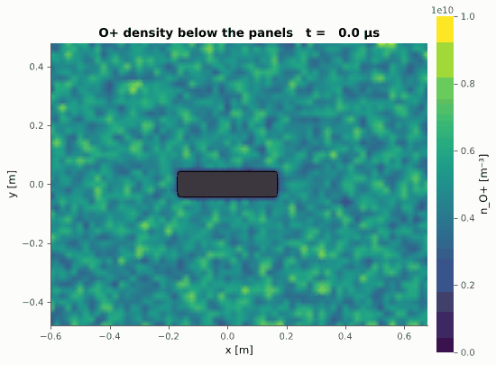<br><em>Ion density below a CubeSat as the wake develops.</em></td>
</tr>
<tr>
<td>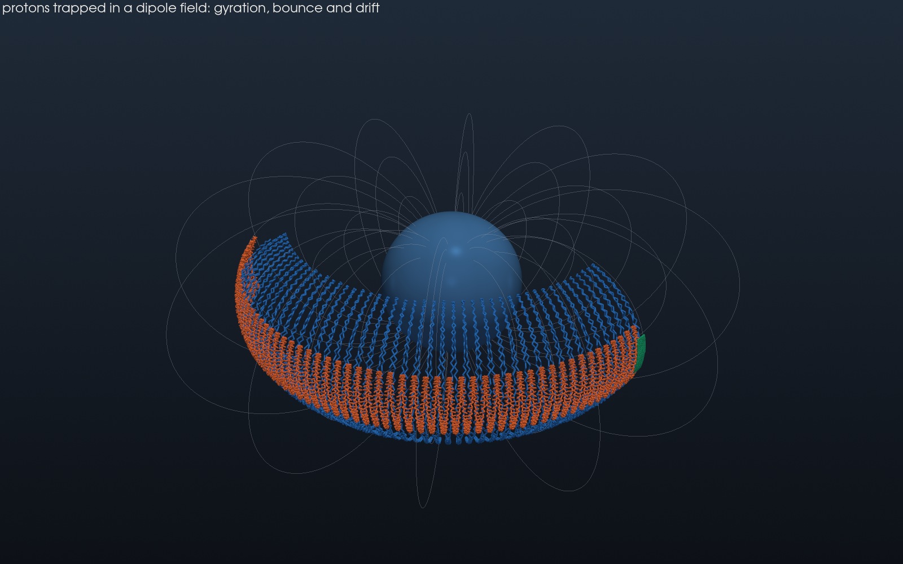<br><em>Protons in a dipole field: gyration, bounce between mirror points and azimuthal drift.</em></td>
<td>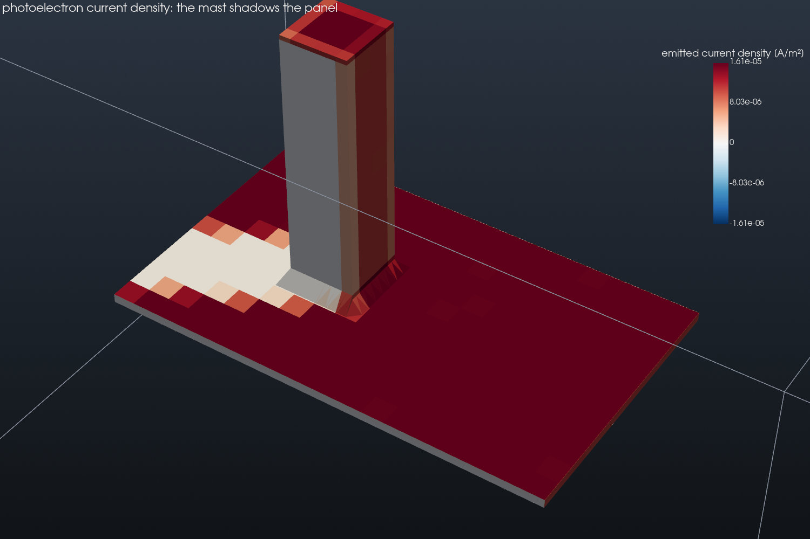<br><em>Photoemission with self-shadowing: a mast shades part of a solar panel.</em></td>
</tr>
</table>

## Building

Requirements: a C++20 compiler, CMake ≥ 3.18, MPI and OpenMP. No other libraries are needed (the
TOML parser is vendored in `extern/`).

```bash
sudo apt install build-essential cmake libopenmpi-dev openmpi-bin     # Debian / Ubuntu
cmake -S . -B build -DCMAKE_BUILD_TYPE=Release
cmake --build build -j
ctest --test-dir build --output-on-failure                           # verification suite
```

CMake options: `PICSP_NATIVE` (default `ON`, compiles with `-march=native`) and `PICSP_TESTS`
(default `ON`).

> **Several MPI installations.** Anaconda/conda, Spack and environment modules often put a second
> MPI (typically MPICH) ahead of the system Open MPI on `PATH`. The code must be compiled and launched
> with the same implementation: an Open MPI binary started by MPICH's `mpirun` silently runs every
> process as an independent single-rank job. CMake prints the MPI library and launcher it found and
> warns if they differ. Pin both explicitly, and launch with the matching `mpirun`:
>
> ```bash
> cmake -S . -B build -DCMAKE_BUILD_TYPE=Release \
>       -DMPI_CXX_COMPILER=/usr/bin/mpicxx -DMPIEXEC_EXECUTABLE=/usr/bin/mpirun
> /usr/bin/mpirun -np 4 build/picsp3d input.toml
> ```
>
> A quick check: the start-up banner prints `MPI ranks: N`; if it shows `1` once per process,
> the launcher and library do not match.

Post-processing needs Python ≥ 3.9:

```bash
pip install -e python               # numpy, matplotlib, pyvista, imageio[-ffmpeg]
pip install -e "python[examples]"   # + scipy, for the feature examples
```

## Running

```bash
export OMP_NUM_THREADS=4
mpirun -np 8 --map-by ppr:2:socket:pe=4 build/picsp3d input.toml
```

Command line: `picsp3d input.toml [--restart DIR] [--steps N] [--output DIR] [--check]`. The
`--check` flag builds the geometry, solver and particle populations, writes the geometry (object ids,
signed distance and the object surfaces as VTK) and exits, which is a quick way to validate an input
file and to inspect imported CAD parts on the grid. The console prints a status line with the step, time, particle counts,
energies, object potentials, solver iterations and particle pushes per second, and a timer
breakdown at the end of the run.

> **Thread binding.** Most MPI launchers pin each rank to a single core by default, which
> silently serialises the OpenMP threads. Give each rank as many cores as threads
> (`--map-by ...:pe=N` in Open MPI, `--cpus-per-task` in Slurm) or use `--bind-to none`. PICSP3D
> prints a warning when it detects fewer available cores than threads.

## A complete input file

Inputs are TOML files. Quantities are SI unless the key says otherwise (`temperature` in eV,
`mass_amu`, `dx_debye`, `dt_wpe`). The example below combines several features: a floating sphere
with secondary emission in a flowing, magnetised plasma with a neutral background.

```toml
title = "Floating sphere in a flowing plasma"
seed = 1

[grid]
cells = [64, 64, 64]
dx_debye = 0.25            # or dx = <metres>, or length = [Lx, Ly, Lz]
centered = true            # origin at the domain centre

[time]
dt_wpe = 0.1               # or dt = <seconds>
steps = 5000

[boundaries]
default = { field = "dirichlet", value = 0.0, particle = "open" }

[fields]
B0 = [0.0, 0.0, 2e-5]      # uniform field [T]

[[fields.magnet]]          # optional: add any number of analytic sources
type = "dipole"
center = [0.0, 0.0, 0.0]
moment = [0.0, 0.0, 1.0]   # A m^2

[[species]]
name = "electron"
charge = -1
mass_me = 1
density = 1e12
temperature = 1.0
ppc = 16

[[species]]
name = "H+"
charge = 1
mass_amu = 1.007
density = 1e12
temperature = 0.1
drift = [4e4, 0.0, 0.0]

[[objects]]
name = "sphere"
shape = "sphere"
radius = 0.01
bias = "floating"
see = { model = "sternglass", delta_max = 1.5, e_max = 300.0 }

[collisions]
neutral_density = 1e19
neutral_temperature = 0.026
neutral_mass_amu = 1.008
  [[collisions.process]]
  species = "H+"
  type = "charge_exchange"
  cross_section = 5e-19

[coulomb]
coulomb_log = "auto"

[output]
fields_every = 500
surface_every = 500
history_every = 10
```

Every key is documented in [`docs/input_reference.md`](docs/input_reference.md) and the numerical
methods in [`docs/numerics.md`](docs/numerics.md).

## Features in detail

### Electrostatic field solver

Poisson's equation is solved on the nodes of a uniform Cartesian grid. The default solver is a
conjugate gradient method preconditioned by a geometric multigrid V-cycle, with BiCGStab as a
fallback when cut-cell stencils make the operator non-symmetric. The iteration count is essentially
independent of the grid size (7 to 8 iterations to 1e-10 on manufactured solutions). Object
surfaces enter through Shortley-Weller cut-cell stencils using the exact signed distance, which
makes the boundary condition second order and the surface potential converge at third order. Fully
periodic problems are handled with a zero-mean projection. In **test-particle mode**
(`[fields] self_consistent = false`) the solve is skipped and particles move in the external
fields only, which is ideal for orbit studies, swarm simulations and collision benchmarks.

### Magnetic fields

A uniform background field `B0` can be combined with any number of analytic sources, evaluated
once on the grid and gathered per particle:

| Source | Description |
|---|---|
| `dipole` | point dipole with arbitrary moment vector, e.g. a planetary field |
| `loop` | circular current loop, exact off-axis field from complete elliptic integrals |
| `solenoid` | finite solenoid built from coaxial loops |
| `mirror` | magnetic bottle made of two coaxial loops |
| `wire` | infinite straight current-carrying wire |

The Boris rotation uses the local field, so magnetic moment conservation, mirror reflection,
gradient and curvature drifts all emerge naturally (see examples 04 and 05). A frame velocity
(`frame_velocity`) adds the motional electric field −v × B0 seen by a moving spacecraft.

### Objects and geometry

Objects are described by signed distance functions. Primitives (sphere, box with optional rounded
edges, cylinder, cone, torus, ellipsoid, plate, half-space) can be translated, rotated, scaled and
combined with constructive solid geometry. Triangulated **STL** files (ASCII or binary, any CAD
export) are imported with a bounding volume hierarchy for exact distances and the fast generalised
winding number for robust inside/outside tests, so overlapping shells and inconsistent triangle
orientation are handled without boolean preprocessing. Thin structures such as solar panels and
booms, thinner than a cell, are resolved as conductor sheets in the field solve and exactly in the
particle collision test. Object surfaces are triangulated (marching tetrahedra) into panels that
carry the current densities.

**Importing CAD parts.** An STL file is placed with the input keys `units` (m, cm, mm, um, in,
ft), `anchor` (which point of the mesh goes to `center`: the CAD origin, the bounding-box centre,
the volume centroid, the minimum corner or the base), `fit` (rescale to a given size) and
`rotate`. At start-up the solver reports every mesh (triangles, watertightness, size, area,
volume) and every object's extent in cells, and warns about objects that leave the domain or
crowd a boundary. The `picsp-post mesh` tool does the preparation:

```bash
python -m picsp_post mesh info   part.stl                       # size, units guess, topology
python -m picsp_post mesh import part.stl --units mm --anchor center --name probe \
       --cells-across 24 --margin 1.0 -o probe.toml --preview probe.png
picsp3d input.toml --check --output geometry_check                  # inspect on the grid
```

`mesh import` writes a ready-to-paste `[[objects]]` block and a `[grid]` sized around the object,
plus a three-view preview on the cell grid. The full workflow, including tips for preparing CAD
files, is in [`docs/geometry_import.md`](docs/geometry_import.md).

<p align="center">
  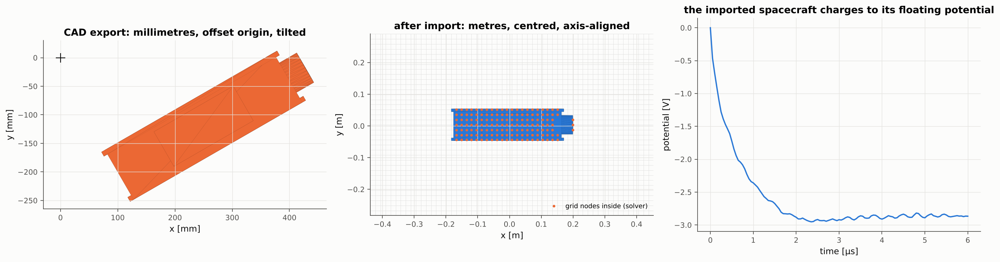<br>
  <em>A CAD export in millimetres with an offset origin and a tilt (left) is placed centred and
  axis-aligned in the domain by <code>units</code>, <code>anchor</code> and <code>rotate</code>
  (middle; dots are the grid nodes the solver marks inside), and charges in a plasma (right).</em>
</p>

### Object charging

Each object is either held at a fixed potential, which may be ramped in time for probe sweeps, or
**floating**. Floating conductors are charged by the collected and emitted currents and their
potential follows from the capacitance-matrix method, which gives the exact potential consistent
with the plasma charge every step. Several parts can be electrically connected into a group,
objects can be isolated from each other (a probe on a boom), and external capacitance and bias
currents can be added.

### Surface emission

* **Secondary electron emission** with the Sternglass yield curve (peak yield and energy as
  inputs) or a constant yield; secondaries leave the surface with a half-Maxwellian of chosen
  temperature and can be assigned to their own species.
* **Ion-induced electron emission** with a constant yield.
* **Photoemission** with a current density at normal incidence, cosine dependence on the sun
  angle and **self-shadowing** computed by ray casting through the full geometry, so parts of a
  spacecraft shade each other.

### Particles and velocity distributions

Species are defined by charge, mass, density, temperature and drift. Thermal velocities can be
sampled from a Maxwellian, a bi-Maxwellian with arbitrary anisotropy axis, a kappa distribution,
a ring distribution or a cold beam. Positions are loaded randomly or with a quiet Halton sequence,
optionally with a sinusoidal density perturbation. Open boundaries inject the ambient distribution
with the correct one-sided flux, including drifts. Heavy species can be sub-cycled.

### Collisions with a neutral background

The null-collision Monte Carlo method handles elastic scattering, resonant charge exchange,
excitation with energy loss and **electron-impact ionisation**, which creates a secondary electron
and an ion so that discharges and avalanches can be modelled. Cross sections can be constant,
a step above a threshold, the Lotz ionisation formula or tabulated σ(E) given inline or in a
two-column file (for instance converted from LXCat).

### Coulomb collisions

Binary Coulomb collisions between charged macro-particles in the same cell follow the
Takizuka-Abe method, for every species pair or for a selected list. Particles with different
weights are handled with the Nanbu-Yonemura acceptance rule. The Coulomb logarithm is given or
computed from the reference plasma, and collisions can be performed every N steps. Temperature
equilibration and isotropisation agree with the Spitzer and NRL rates (example 15).

### Parallelisation

The domain is split into a 3D Cartesian grid of MPI ranks (chosen automatically to minimise the
halo surface, or given). Fields carry two ghost layers. Particles migrate dimension by dimension in
a single neighbour exchange per axis while keeping their order, so runs are reproducible for a
given rank and thread count, and restarts are bit-identical. Within a rank, OpenMP threads share
the particle arrays with static schedules, thread-private deposition buffers and independent
random streams.

## Feature examples

[`examples/features/`](examples/features) contains one small, self-contained run per feature, each
with an input file, an analysis script that compares against theory and a short README. They run
in seconds to a few minutes on a laptop:

```bash
cd examples/features
python3 run_example.py                         # list the examples
python3 run_example.py 04_magnetic_mirror            # simulate and analyse
python3 run_example.py all
python3 run_example.py 04_magnetic_mirror --analyze-only
```

| # | Example | Feature | Result |
|---|---|---|---|
| 01 | [Langmuir oscillation](examples/features/01_langmuir_oscillation) | periodic electrostatics, quiet start | ω = 1.257 ω_pe vs 1.276 ω_pe from the kinetic dispersion relation |
| 02 | [Two-stream instability](examples/features/02_two_stream_instability) | beams, phase space | growth rate 0.484 ω_b vs 0.500 ω_b |
| 03 | [Gyration and E × B drift](examples/features/03_gyration_ExB_drift) | Boris push, test particles, tracks | drift 1.00 × 10⁵ m/s, independent of charge and mass |
| 04 | [Magnetic mirror](examples/features/04_magnetic_mirror) | current-loop B sources | trapped fraction 0.841 vs loss-cone theory 0.839 |
| 05 | [Dipole trapping](examples/features/05_dipole_trapping) | dipole B, adiabatic invariants | stable bounce at ±8° latitude and steady azimuthal drift |
| 06 | [Velocity distributions](examples/features/06_velocity_distributions) | Maxwellian, bi-Maxwellian, kappa, ring, beam | sampled moments and tails match the analytic forms |
| 07 | [Floating sphere](examples/features/07_floating_sphere_OML) | capacitance-matrix charging, open boundaries | V_f = −1.51 V vs OML −1.42 V |
| 08 | [Sphere wake](examples/features/08_sphere_wake) | mesothermal flow, ion wake | ion void and downstream focusing to about 2 n₀, positive wake potential |
| 09 | [Langmuir probe I-V](examples/features/09_langmuir_probe_IV) | swept bias, current collection | T_e = 2.21 eV from the retardation slope (input 2.0 eV), V_f = −2.45 V |
| 10 | [Secondary emission](examples/features/10_secondary_emission) | Sternglass SEE, floating plates | −45 V and still charging without SEE, −0.4 V with SEE; current balance closes |
| 11 | [Photoemission and shadowing](examples/features/11_photoemission_shadowing) | photoemission, ray-cast shadows, connected parts | charges positive to +2.6 V (saturating near 3 V); mast casts a photoemission shadow on the panel |
| 12 | [Spacecraft from STL](examples/features/12_spacecraft_STL) | STL import, CSG, isolated probe, all surface physics | spacecraft floats at −1.53 V, isolated probe at −1.50 V; sunlit panels emit, shadowed faces collect |
| 13 | [Ion mobility](examples/features/13_MCC_ion_mobility) | MCC charge exchange | drift 1017 m/s vs theory 1012 m/s, half-Gaussian distribution |
| 14 | [Ionisation avalanche](examples/features/14_ionization_avalanche) | ionisation, excitation, Lotz cross section | steady swarm, exponential multiplication ν_i = 1.4 × 10⁸ s⁻¹ |
| 15 | [Coulomb relaxation](examples/features/15_coulomb_relaxation) | Takizuka-Abe collisions | e-i equilibration and isotropisation follow Spitzer / NRL rates |
| 16 | [CAD import](examples/features/16_mesh_import) | `mesh import` tool, STL `units` / `anchor` / `rotate`, `--check` | mm export with offset and tilt placed centred and axis-aligned; floats at −2.86 V |

<table>
<tr>
<td width="50%">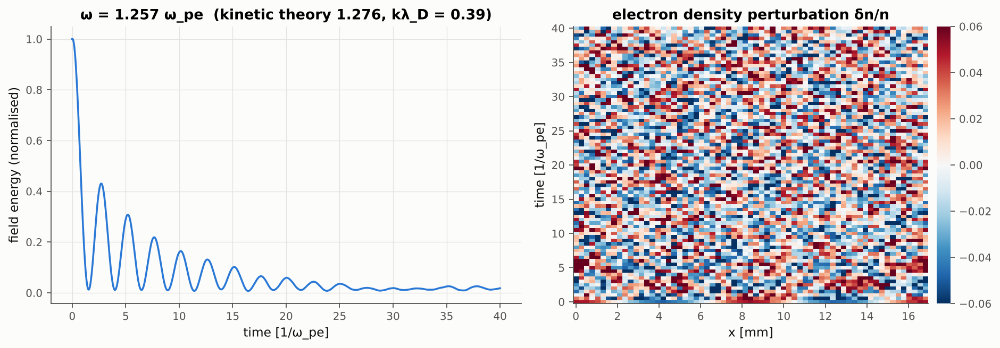<br><em>01: Langmuir oscillation.</em></td>
<td width="50%">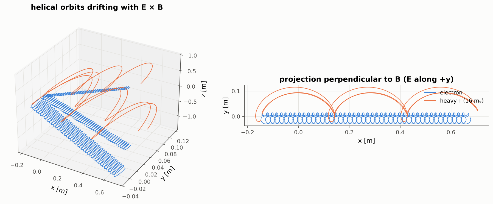<br><em>03: gyration and E × B drift of electrons and ions.</em></td>
</tr>
<tr>
<td>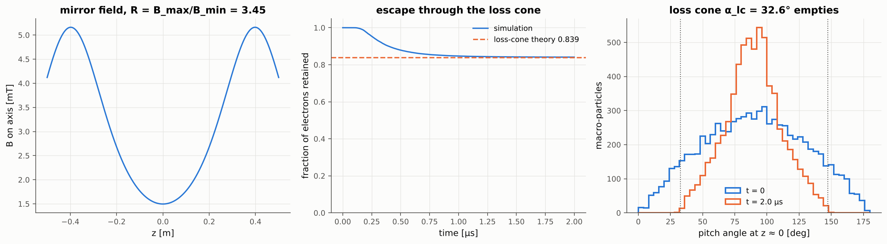<br><em>04: mirror confinement and the loss cone.</em></td>
<td>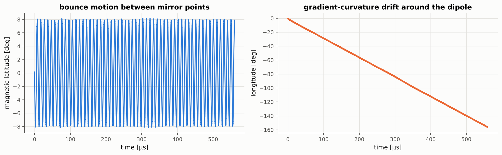<br><em>05: bounce and drift in a dipole field.</em></td>
</tr>
<tr>
<td>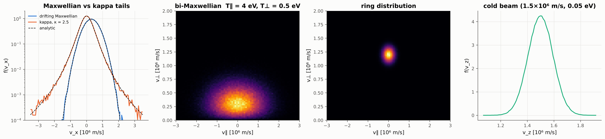<br><em>06: velocity distribution samplers.</em></td>
<td>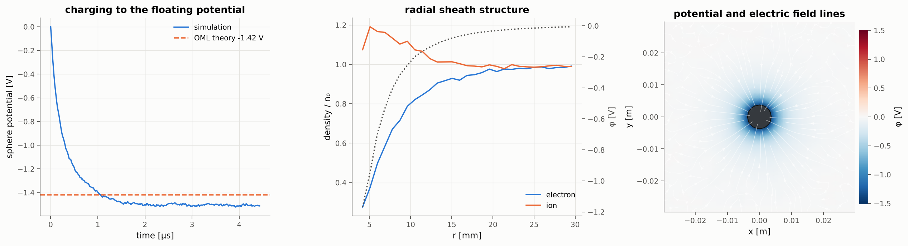<br><em>07: charging of a floating sphere and its sheath.</em></td>
</tr>
<tr>
<td>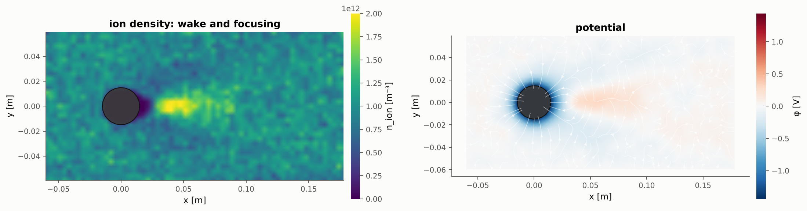<br><em>08: ion wake behind a sphere.</em></td>
<td>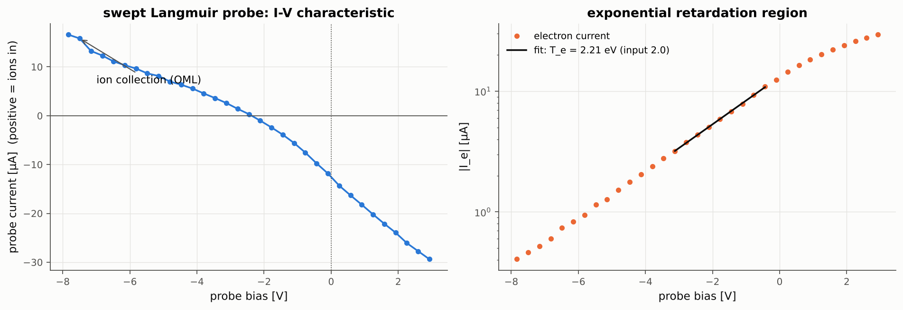<br><em>09: Langmuir probe characteristic.</em></td>
</tr>
<tr>
<td>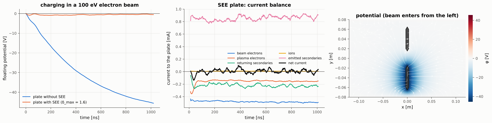<br><em>10: plates with and without secondary emission.</em></td>
<td>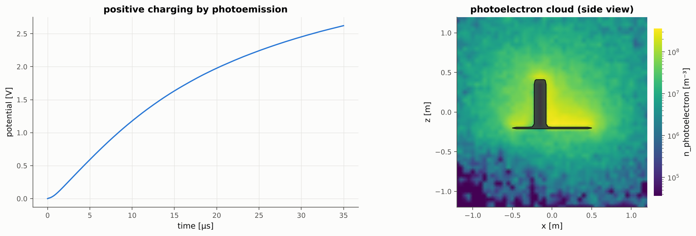<br><em>11: photoemission charging.</em></td>
</tr>
<tr>
<td>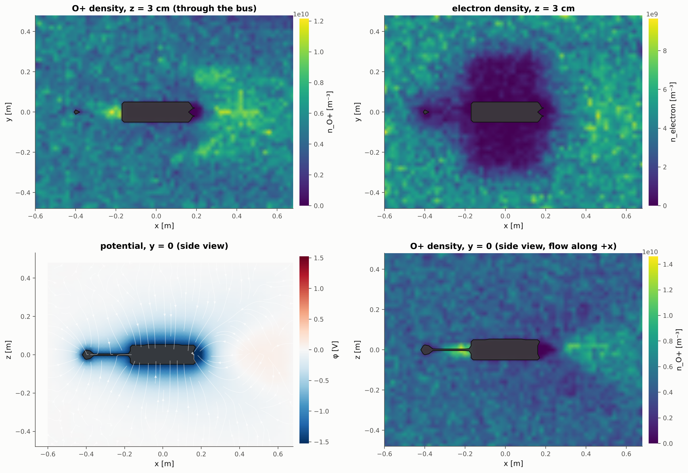<br><em>12: CubeSat plasma environment.</em></td>
<td>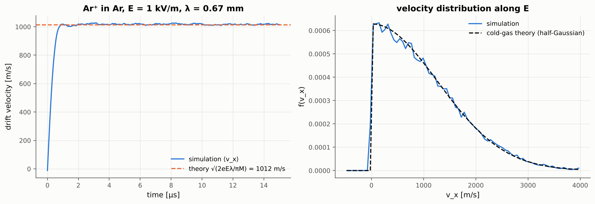<br><em>13: ion mobility with charge exchange.</em></td>
</tr>
<tr>
<td>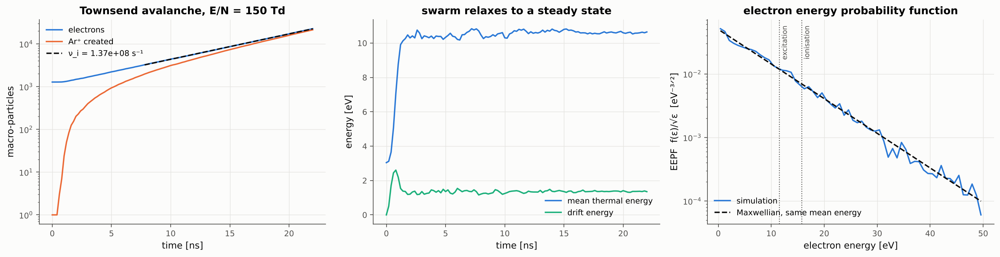<br><em>14: ionisation avalanche in argon.</em></td>
<td>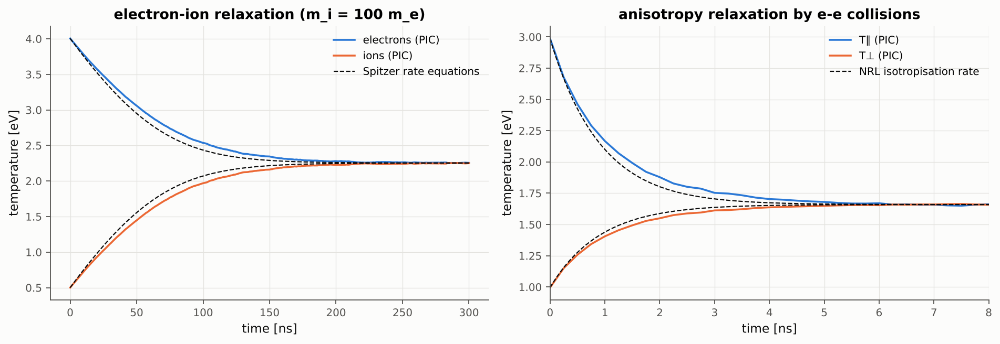<br><em>15: Coulomb temperature relaxation.</em></td>
</tr>
</table>

Larger production inputs (a swept probe in a magnetised plasma, a collisional electrode, a CubeSat
wake on more cores) are in [`examples/`](examples).

## Output and post-processing

Each run directory contains

* `fields.pvd`: potential `phi`, charge density `rho`, electric field `E`, magnetic field `B`
  (when spatially varying), per-species density `n_<s>`, mean velocity `u_<s>` and temperature
  `T_<s>` (eV), object ids and the signed distance `sdf`;
* `surface.pvd`: triangulated object surfaces with potential, sun incidence and current densities
  `J_<species>`, `J_emit`, `J_net` (A/m², averaged over the output interval);
* `particles.pvd`: sub-sampled macro-particles with velocity, energy, weight and species;
* `history.csv`: per species the particle count, kinetic energy, temperature (total and per axis)
  and mean velocity; field and total energy; conductor potentials and charges; collected and
  emitted currents per object and species; wall losses; solver iterations; collision and
  ionisation counts; wall-clock time;
* `tracks.csv`: trajectories of selected particles (`track_every`, `track_count`);
* `checkpoint/`: restart files (one per rank).

The `.pvd` files open directly in ParaView as time series. The `picsp_post` package provides a
command line interface and a Python API:

```bash
python -m picsp_post info      output
python -m picsp_post history   output                       # energies, potentials, currents
python -m picsp_post slice     output -f phi -a z --streamlines
python -m picsp_post slice     output -f n_O+ -a z --log
python -m picsp_post phase     output -s electron -x x -v vx
python -m picsp_post render    output --surface J_net --particles
python -m picsp_post animate   output -f n_electron -a y      # MP4 (or .gif with -o name.gif)
python -m picsp_post animate   output --scene --orbit         # 3D movie
python -m picsp_post mesh info part.stl                       # CAD import, see docs/geometry_import.md
```

```python
from picsp_post import Run, plots
run = Run("output")
phi = run.field_array(-1, "phi")          # numpy array (nx+1, ny+1, nz+1)
h = run.history()                         # dict of numpy arrays from history.csv
plots.plot_slice(run, "phi", axis="y", streamlines=True)
```

Rendering works off-screen, so figures and movies can be produced on clusters without a display.

## Verification

The `ctest` suite runs every test serially and on 4 MPI ranks:

| Test | Result |
|---|---|
| Poisson, manufactured solutions (Dirichlet, periodic, Neumann) | second-order convergence, 7 to 8 MG-PCG iterations to 1e-10 independent of grid size |
| Concentric-sphere capacitor (CSG cavity) | capacitance error 0.08% with cut cells (−4.6% staircase); potential error converges at third order |
| Gyration in uniform B | gyro-frequency error 3e-5, speed conserved to round-off |
| E × B drift across ranks and periodic boundaries | 0.25% |
| Reflecting and absorbing walls | exact time of flight |
| Current loop field vs Biot-Savart quadrature, dipole | 1e-13, exact |
| Magnetic mirror orbit | magnetic moment conserved to 0.3%, mirror point within 0.1% of theory, passing particle escapes |
| Velocity samplers | Maxwellian, kappa (kurtosis) and bi-Maxwellian moments within sampling error |
| MCC elastic and charge exchange | momentum relaxation exp(−νt) within 1% |
| Ionisation rate coefficient for a Maxwellian | within 2% of the analytic value, one secondary per ion |
| Coulomb e-e and e-i temperature relaxation | within 10% of Spitzer at practical time steps, energy conserved to 1e-14 |
| STL import | no sign errors on 20000 random points; overlapping shells handled |
| Mesh placement (`units`, `anchor`, `fit`, `rotate`) | placement exact to round-off; area and volume of a meshed sphere within 1%; Python tool tests (`pytest tests/python`) |
| Checkpoint / restart | bit-identical to an uninterrupted run |

## Performance notes

<p align="center">
  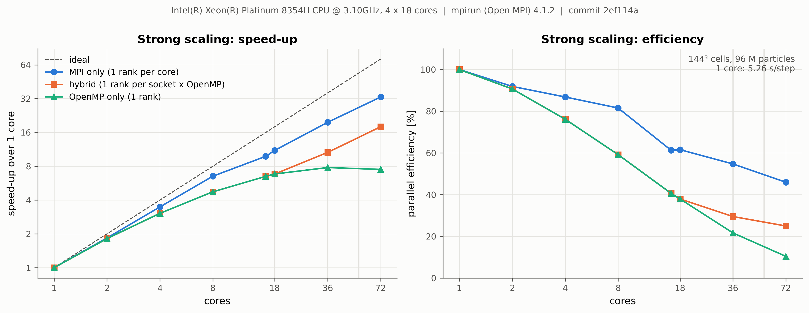
</p>

On a four-socket Xeon Platinum 8354H node (72 cores), a 144³ grid with 96 M particles runs at
5.3 s per step on one core and 0.16 s per step on 72 MPI ranks, a speed-up of 33. One MPI rank per
core is the fastest layout; threads should never span sockets. The field solve and, for threaded
ranks, the cell sort are what limit scaling. [docs/performance.md](docs/performance.md) has the
strong- and weak-scaling results, a per-stage breakdown and advice on choosing ranks and threads;
[`benchmarks/scaling`](benchmarks/scaling) reruns the benchmark on any machine.

* Particles are stored as structure of arrays and sorted by cell periodically, so gather and
  deposition access memory contiguously; the push loop vectorises.
* Deposition uses thread-private buffers reduced in parallel; halos are exchanged once per step.
* The multigrid-preconditioned solver keeps the Poisson cost at a few percent of the step for
  typical particle counts; floating conductors cost one extra solve per conductor at setup only.
* A test-particle run with a spatially varying field (example 04) takes about 0.8 ms per step on
  two cores; the status line reports particle pushes per second so scaling can be checked directly.
* The time step and grid are checked at start-up against the plasma period, the gyro-period and
  the Debye length, with warnings for poorly resolved cases.

## Code layout

```
src/
  config/      TOML input -> SI configuration
  parallel/    Cartesian MPI decomposition
  grid/        distributed node fields with ghost layers and halo exchange
  geometry/    signed-distance primitives, CSG, STL + BVH + winding numbers
  fields/      embedded boundary, multigrid Krylov Poisson solver, conductors, E and B fields
  particles/   species, velocity samplers, Boris push, deposition, migration, injection, sorting
  objects/     surface panels, charging, secondary and photoemission
  collisions/  Monte Carlo neutral collisions, Coulomb collisions
  io/          parallel VTK writers
python/picsp_post   post-processing package and the `mesh` CAD import tool
tests/              verification suite (ctest) and Python tests (tests/python)
examples/           production inputs, geometry generator, analysis scripts
examples/features/  one example per feature with analysis
docs/               input reference, numerical methods, logo, figures
legacy/             original 2D PICSP code
```

## Limitations and roadmap

* Electrostatic: the magnetic field is static (uniform and/or from analytic sources); an
  electromagnetic or Darwin solver is a natural extension, and the field and particle interfaces
  are separated for it.
* Static domain decomposition, no dynamic load balancing yet.
* Objects must lie inside the domain on periodic axes (no periodic images of objects).
* Neutral gas is a uniform background (no neutral transport or depletion).

## License

See [LICENSE](LICENSE).
