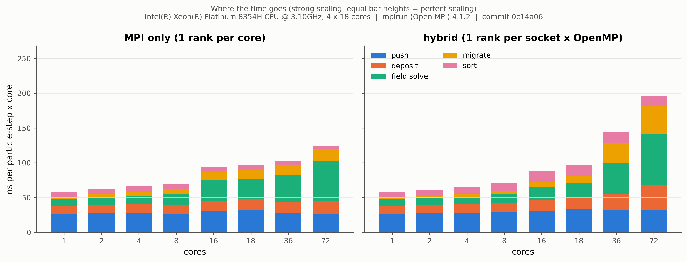
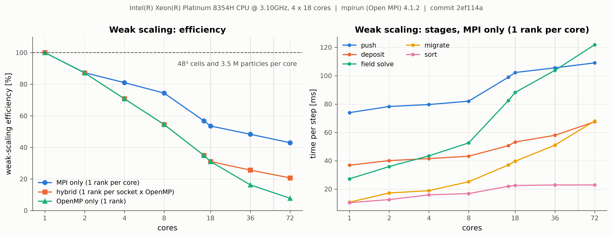

# Performance and scaling

This page reports strong- and weak-scaling measurements of PICSP3D on a single four-socket node,
explains where the time goes, and gives practical advice on choosing MPI ranks and OpenMP threads.
The benchmark is in [`benchmarks/scaling`](../benchmarks/scaling) and can be rerun on any machine:

```bash
python3 benchmarks/scaling/run_scaling.py --quick            # checks the setup in about a minute
python3 benchmarks/scaling/run_scaling.py                    # full sweep: about an hour on 72 cores
python3 benchmarks/scaling/plot_scaling.py benchmarks/scaling/results/<machine>
```

The driver detects sockets and cores with `lscpu`, pins ranks and threads to physical cores (Open
MPI), keeps the faster of two runs per point and writes `strong.csv`, `weak.csv` and `system.json`
(CPU, MPI, compiler, commit) to `benchmarks/scaling/results/<cpu-model>/`. Use `--mpirun` to pick
the MPI launcher when several MPI installations are present.

## Test problem and machine

A fully periodic, thermal hydrogen plasma: electrons at 1 eV, protons at 0.1 eV, 16 particles per
cell and species, cell size 0.5 λ_D, 40 steps of 0.1/ω_pe, no output. Every step runs the full
cycle (push, migration between ranks, deposition, multigrid-preconditioned CG Poisson solve and
E-field gather, cell sort every 20 steps), so the numbers reflect a production step rather than a
single kernel.

| | |
|---|---|
| CPU | 4 × Intel Xeon Platinum 8354H (Cooper Lake), 18 cores each, 72 cores, 4 NUMA domains |
| Memory | 1.5 TB DDR4 |
| Software | Ubuntu 22.04, GCC 11.4 (`-O3 -march=native`), Open MPI 4.1.2 |
| Strong scaling | 144³ cells, 95.6 M particles (fixed) |
| Weak scaling | 48³ cells and 3.5 M particles per core (72 cores: 288 × 192 × 144 cells, 255 M particles) |

Three ways of using the cores are compared:

* **MPI only**: one rank per core, one thread each;
* **hybrid**: one rank per socket, one OpenMP thread per core of that socket (identical to
  OpenMP only up to 18 cores);
* **OpenMP only**: a single rank whose threads span all sockets.

The machine is shared; each point is the faster of two runs. Points repeated in a separate
session agreed to within 3–8 %.

## Strong scaling


| cores | MPI only | | hybrid | | OpenMP only | |
|---:|---:|---:|---:|---:|---:|---:|
| | ms/step | speed-up | ms/step | speed-up | ms/step | speed-up |
| 1 | 5263 | 1.0 | 5263 | 1.0 | 5263 | 1.0 |
| 8 | 807 | 6.5 | 1111 | 4.7 | 1111 | 4.7 |
| 18 | 475 | 11.1 | 771 | 6.8 | 771 | 6.8 |
| 36 | 267 | 19.7 | 495 | 10.6 | 675 | 7.8 |
| 72 | **159** | **33.1** | 293 | 18.0 | 702 | 7.5 |

One core advances a particle by one step in 55 ns, including its share of the field solve. With one
MPI rank per core the code reaches a speed-up of 33 on 72 cores (46 % efficiency); a step with
96 M particles takes 0.16 s.

## Where the time goes



The bars show the cost of each stage in nanoseconds per particle-step and core. With perfect
scaling they would all have the height of the 1-core bar.

* **Push and deposit** scale well in both layouts; they are the bulk of the work.
* **Field solve.** The Poisson solve grows from 16 % of the step on one core to 47 % on 72 MPI
  ranks. The multigrid hierarchy is built per rank and stops coarsening when a rank's subdomain
  has fewer than four cells per axis, so more ranks mean fewer levels (5 on one core, 3 on 72
  ranks) and a larger coarsest grid that is smoothed rather than solved. The CG iteration count
  stays at 6–7, so convergence is not the issue; the coarse-level work and the global reductions
  per iteration are.
* **Sort.** The periodic cell sort is a counting sort whose histogram and scatter passes run on one
  thread per rank. With MPI only, every rank sorts its own particles and the cost shrinks with the
  rank count. Within a threaded rank it barely shrinks: with one rank of 18 threads, sorting takes
  353 ms of a 771 ms step. This was the main reason the hybrid layout trailed MPI only; the sort
  is now threaded (see [Parallel cell sort](#parallel-cell-sort-after-these-measurements)).
* **Migrate** (moving particles between ranks) grows with the number of rank boundaries but stays
  at or below 15 % of the step.

## Weak scaling



With a fixed 48³ cells and 3.5 M particles per core, the MPI-only time per step rises from 159 ms
on one core to 371 ms on 72 cores (43 % weak-scaling efficiency). The increase has three parts:

* **Filling a socket** (8 → 18 cores): push and deposit per core rise by about 25 % (push 82 →
  102 ms) as the cores of a socket share its memory bandwidth, which no layout can avoid. Across
  sockets the push stays nearly flat (102 → 109 ms), as each socket brings its own memory channels.
* **Field solve**: 27 → 122 ms, for the reasons above.
* **Rank boundaries**: migration grows from 40 to 68 ms and deposition (which includes the halo
  exchange of the charge density) from 53 to 68 ms between 18 and 72 cores.

## Choosing ranks and threads

* **Prefer one MPI rank per core.** In the measurements above it is 1.8 times faster than one
  rank per socket with threads, and 4.4 times faster than a single rank on all cores. With the
  threaded sort, one rank of 18 threads on a socket is about 5 % slower than 18 MPI ranks, so threads are
  now a reasonable choice when fewer ranks are wanted (memory per rank, fewer halo cells).
* **Never let one rank's threads span sockets.** The OpenMP-only curve stops improving beyond one
  socket (36 and 72 threads are no faster than 18) because threads read memory attached to other
  sockets. If you use threads, use at least one rank per NUMA domain
  (`--map-by ppr:1:numa:pe=N` in Open MPI).
* **Pin ranks and threads.** Use `--bind-to core` (MPI only) or `--map-by ...:pe=N` with
  `OMP_PLACES=cores OMP_PROC_BIND=close` (hybrid). See *Thread binding* in the README.
* **Keep subdomains divisible.** The multigrid levels depend on every rank's cell count being even
  at each level. A grid such as 144³ (divisible by 2, 3, 4, 6, 8, 9, 12, 16, 18, 24, 36, 48, 72)
  keeps 3 to 5 levels for any rank count used here; the start-up log prints the number of levels.

## Solver threading (this release)

The measurements above include a change to the multigrid solver: several per-iteration passes over
the grid (mean projection for periodic problems, masking of fixed nodes, field copies, the halo
pack and unpack and the set-up of the right-hand side) ran on one thread. They are now threaded.
For a 128³ periodic grid on one socket, the field solve dropped from 223 ms to 73 ms per step with
18 threads, and its 18-thread speed-up rose from 2.7 to 8.1. Single-thread performance and
results are unchanged; with one thread per rank, restarts remain bit-identical.

## Parallel cell sort (after these measurements)

The figures above were measured before the cell sort was threaded. The sort is now a parallel
stable counting sort: every chunk of particles gets its own histogram, and the write offsets run
cell by cell and, within a cell, chunk by chunk, so the particle order is exactly the one the
serial sort produced, for any thread count (checked in `test_particles`). Measured on one socket
of the same machine (same 144³ strong-scaling problem; the 18 MPI-rank reference reproduced the
earlier value to within 2 %):

| one rank | sort before | sort after | step before | step after |
|---|---:|---:|---:|---:|
| 8 threads | 380 ms | 136 ms | 1111 ms | 844 ms |
| 16 threads | 365 ms | 90 ms | 809 ms | 525 ms |
| 18 threads | 353 ms | 85 ms | 771 ms | 508 ms |
| *18 MPI ranks (reference)* | *39 ms* | *38 ms* | *475 ms* | *483 ms* |

Times are per step; the sort runs every 20 steps and its cost is averaged over all steps. The
multi-socket points of that run were taken while other jobs loaded the machine and are not shown;
the figures will be regenerated from a full sweep on a quiet machine.

## Known limitations and next steps

* Agglomerate the coarse multigrid levels onto fewer ranks so that the hierarchy no longer becomes
  shallower as ranks are added.
