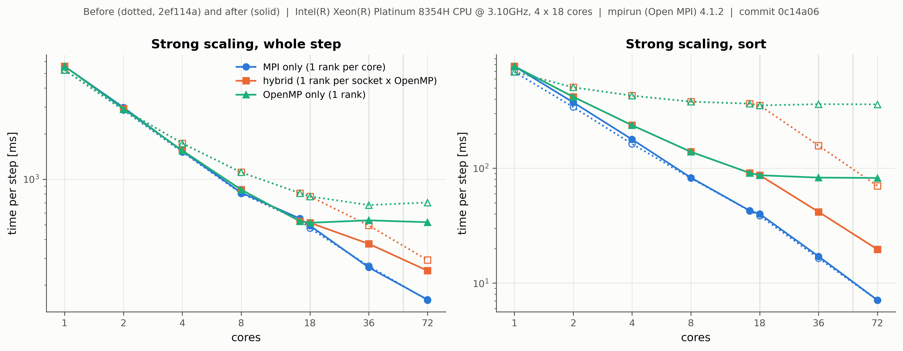

# Performance and scaling

This page reports strong- and weak-scaling measurements of PICSP3D on a single four-socket node,
explains where the time goes, and gives practical advice on choosing MPI ranks and OpenMP threads.
The benchmark is in [`benchmarks/scaling`](../benchmarks/scaling) and can be rerun on any machine:

```bash
python3 benchmarks/scaling/run_scaling.py --quick            # checks the setup in about a minute
python3 benchmarks/scaling/run_scaling.py                    # full sweep: about an hour on 72 cores
python3 benchmarks/scaling/plot_scaling.py benchmarks/scaling/results/<machine>
```

The driver detects sockets and cores with `lscpu`, pins ranks and threads to physical cores (Open
MPI), keeps the faster of two runs per point and writes `strong.csv`, `weak.csv` and `system.json`
(CPU, MPI, compiler, commit) to `benchmarks/scaling/results/<cpu-model>/`. Use `--mpirun` to pick
the MPI launcher when several MPI installations are present.

## Test problem and machine

A fully periodic, thermal hydrogen plasma: electrons at 1 eV, protons at 0.1 eV, 16 particles per
cell and species, cell size 0.5 λ_D, 40 steps of 0.1/ω_pe, no output. Every step runs the full
cycle (push, migration between ranks, deposition, multigrid-preconditioned CG Poisson solve and
E-field gather, cell sort every 20 steps), so the numbers reflect a production step rather than a
single kernel.

| | |
|---|---|
| CPU | 4 × Intel Xeon Platinum 8354H (Cooper Lake), 18 cores each, 72 cores, 4 NUMA domains |
| Memory | 1.5 TB DDR4 |
| Software | Ubuntu 22.04, GCC 11.4 (`-O3 -march=native`), Open MPI 4.1.2 |
| Strong scaling | 144³ cells, 95.6 M particles (fixed) |
| Weak scaling | 48³ cells and 3.5 M particles per core (72 cores: 288 × 192 × 144 cells, 255 M particles) |

Three ways of using the cores are compared:

* **MPI only**: one rank per core, one thread each;
* **hybrid**: one rank per socket, one OpenMP thread per core of that socket (identical to
  OpenMP only up to 18 cores);
* **OpenMP only**: a single rank whose threads span all sockets.

The machine is shared; each point is the faster of two runs, taken while the machine was otherwise
idle. The MPI-only points, which the sort change below does not affect, reproduced an earlier sweep
to within 1–5 % (159 vs 160 ms at 72 cores); the single-core reference differed by 6 % between the
two sessions (5.26 vs 5.57 s), which shifts speed-ups but not absolute times.

## Strong scaling


| cores | MPI only | | hybrid | | OpenMP only | |
|---:|---:|---:|---:|---:|---:|---:|
| | ms/step | speed-up | ms/step | speed-up | ms/step | speed-up |
| 1 | 5572 | 1.0 | 5572 | 1.0 | 5572 | 1.0 |
| 8 | 816 | 6.8 | 854 | 6.5 | 854 | 6.5 |
| 18 | 494 | 11.3 | 516 | 10.8 | 516 | 10.8 |
| 36 | 262 | 21.3 | 375 | 14.9 | 535 | 10.4 |
| 72 | **160** | **34.8** | 249 | 22.4 | 520 | 10.7 |

One core advances a particle by one step in 58 ns, including its share of the field solve. With one
MPI rank per core the code reaches a speed-up of 35 on 72 cores (48 % efficiency); a step with
96 M particles takes 0.16 s. Within one socket the layouts are close: one rank of 18 threads is 4 %
slower than 18 MPI ranks.

## Where the time goes


The bars show the cost of each stage in nanoseconds per particle-step and core. With perfect
scaling they would all have the height of the 1-core bar.

* **Push and deposit** scale well in both layouts; they are the bulk of the work.
* **Field solve.** The Poisson solve grows from 16 % of the step on one core to 47 % on 72 MPI
  ranks. The multigrid hierarchy is built per rank and stops coarsening when a rank's subdomain
  has fewer than four cells per axis, so more ranks mean fewer levels (5 on one core, 3 on 72
  ranks) and a larger coarsest grid that is smoothed rather than solved. The CG iteration count
  stays at 6–7, so convergence is not the issue; the coarse-level work and the global reductions
  per iteration are.
* **Sort.** The periodic cell sort is threaded (see [Parallel cell sort](#parallel-cell-sort)); it
  now scales in both layouts and takes 4–8 % of the step.
* **Across sockets, hybrid ranks** spend more time than MPI-only ranks in migration (54 vs 23 ms
  per step at 72 cores), deposition (48 vs 25 ms) and the field solve (97 vs 76 ms). In the
  migration, finding the particles that leave a rank is threaded, but their boundary handling,
  removal, packing and unpacking run on one thread per rank; the threaded deposition sums one
  buffer per thread over the whole subdomain. Both cost more when a rank is large.

## Weak scaling


With a fixed 48³ cells and 3.5 M particles per core, the MPI-only time per step rises from 169 ms
on one core to 372 ms on 72 cores (45 % weak-scaling efficiency). The increase has three parts:

* **Filling a socket** (8 → 18 cores): push and deposit per core rise by about 25 % (push 82 →
  105 ms) as the cores of a socket share its memory bandwidth, which no layout can avoid. Across
  sockets the push stays flat (105 → 106 ms), as each socket brings its own memory channels.
* **Field solve**: 29 → 121 ms, for the reasons above.
* **Rank boundaries**: migration grows from 41 to 67 ms and deposition (which includes the halo
  exchange of the charge density) from 55 to 69 ms between 18 and 72 cores.

## Choosing ranks and threads

* **Prefer one MPI rank per core across sockets.** At 72 cores it is 1.6 times faster than one rank
  per socket with threads (160 vs 249 ms), and 3.3 times faster than a single rank on all cores.
  Within one socket, threads are a reasonable choice (4 % slower than MPI ranks) when fewer ranks
  are wanted, for example to reduce memory per rank or the number of halo cells.
* **Never let one rank's threads span sockets.** The OpenMP-only curve stops improving beyond one
  socket (36 and 72 threads are no faster than 18) because threads read memory attached to other
  sockets. If you use threads, use at least one rank per NUMA domain
  (`--map-by ppr:1:numa:pe=N` in Open MPI).
* **Pin ranks and threads.** Use `--bind-to core` (MPI only) or `--map-by ...:pe=N` with
  `OMP_PLACES=cores OMP_PROC_BIND=close` (hybrid). See *Thread binding* in the README.
* **Keep subdomains divisible.** The multigrid levels depend on every rank's cell count being even
  at each level. A grid such as 144³ (divisible by 2, 3, 4, 6, 8, 9, 12, 16, 18, 24, 36, 48, 72)
  keeps 3 to 5 levels for any rank count used here; the start-up log prints the number of levels.

## Solver threading

Several per-iteration passes of the multigrid solver over the grid (mean projection for periodic
problems, masking of fixed nodes, field copies, the halo pack and unpack and the set-up of the
right-hand side) used to run on one thread. They are now threaded. For a 128³ periodic grid on one
socket, the field solve dropped from 223 ms to 73 ms per step with 18 threads, and its 18-thread
speed-up rose from 2.7 to 8.1. Single-thread performance and results are unchanged; with one thread
per rank, restarts remain bit-identical.

## Parallel cell sort

The cell sort is a parallel stable counting sort: every chunk of particles gets its own histogram,
and the write offsets run cell by cell and, within a cell, chunk by chunk, so the particle order is
exactly the one the serial sort produced, for any thread count (checked in `test_particles`).
Before, its histogram and scatter passes ran on one thread per rank.



Dotted lines: the sweep before the change (commit 2ef114a); solid lines: after (0c14a06).

| strong scaling, 144³ cells | sort before | sort after | step before | step after |
|---|---:|---:|---:|---:|
| 1 rank × 18 threads | 353 ms | 87 ms | 771 ms | 516 ms |
| hybrid, 2 × 18 | 158 ms | 42 ms | 495 ms | 375 ms |
| hybrid, 4 × 18 | 70 ms | 20 ms | 293 ms | 249 ms |
| OpenMP only, 72 threads | 360 ms | 82 ms | 702 ms | 520 ms |
| *MPI only, 72 ranks (unaffected)* | *7 ms* | *7 ms* | *159 ms* | *160 ms* |

Times are per step; the sort runs every 20 steps and its cost is averaged over all steps. In weak
scaling the hybrid layout on 72 cores went from 771 to 605 ms per step.

## Known limitations and next steps

* Agglomerate the coarse multigrid levels onto fewer ranks so that the hierarchy no longer becomes
  shallower as ranks are added.
* Thread the boundary handling, packing and unpacking of migrating particles, and sum the per-thread deposition
  buffers over the touched region only, to close the remaining gap between hybrid and MPI-only
  ranks across sockets.
