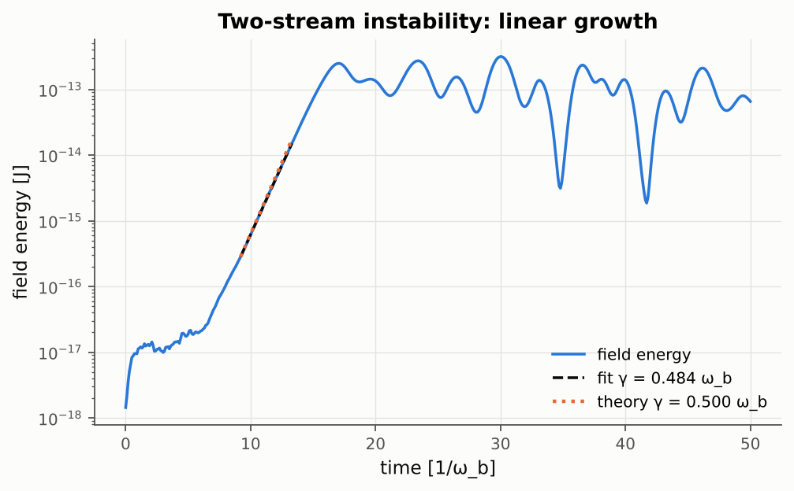

# 02 Two-stream instability

**Feature:** kinetic beam-plasma physics, multiple species with drifts, quiet start with a
seed perturbation, particle output for phase-space diagnostics.

Two counter-streaming cold electron beams are unstable; the box mode grows at the rate given by
the cold-beam dispersion relation 1 = ω_b²/(ω−kv₀)² + ω_b²/(ω+kv₀)² and saturates by trapping,
forming the classic phase-space vortex. The analysis fits the linear growth rate and renders a
phase-space movie.

## Result

Growth rate 0.484 ω_b against 0.500 ω_b from the cold-beam dispersion relation.

Run with `python3 ../run_example.py 02_two_stream_instability` (from this directory) or `python3 run_example.py 02_two_stream_instability` from `examples/features`.
