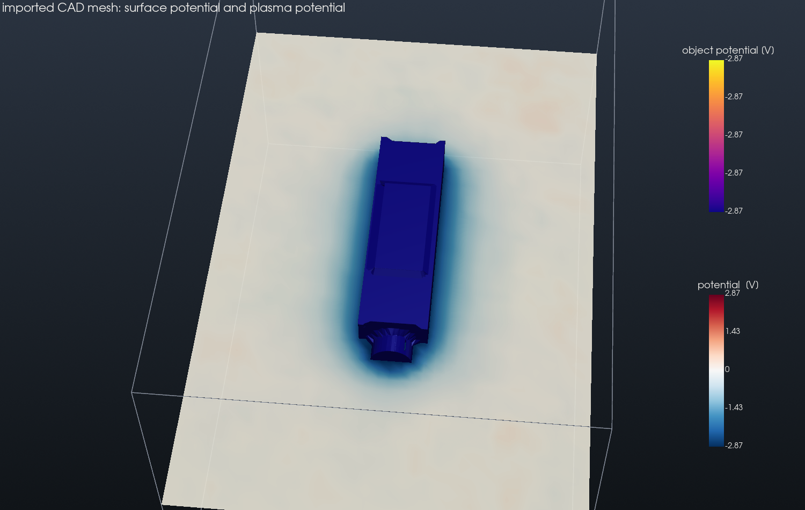

# 16 Importing CAD geometry (STL)

**Feature:** the mesh import workflow: `picsp-post mesh info` and `mesh import`, the STL input
keys `units`, `anchor`, `fit`, `rotate`, the mesh report printed at start-up and the geometry
output of `picsp3d --check`.

`cad/cubesat_mm.stl` mimics a typical CAD export: coordinates in millimetres, an origin far from
the part and a 30° tilt (create it with `python3 cad/make_cad_export.py`). One command turns it
into input blocks:

```bash
python -m picsp_post mesh info   cad/cubesat_mm.stl --units mm
python -m picsp_post mesh import cad/cubesat_mm.stl --units mm --anchor center \
       --rotate 0 0 -30 --name cubesat --cells-across 24 --margin 0.6 \
       -o object.toml --preview preview.png
```

`object.toml` holds a `[grid]` sized around the object and the `[[objects]]` block; both are
pasted into `input.toml` together with the plasma. Before running, check the placement:

```bash
picsp3d input.toml --check --output geometry_check    # writes object_id, sdf and the surface
```

The spacecraft then charges to its floating potential in a hydrogen plasma.

```bash
python3 ../run_example.py 16_mesh_import
```

## Result

The solver places the mesh exactly where the tool predicts (same bounding box to round-off,
24.0 cells across), and the imported spacecraft floats at −2.86 V in the 1 eV hydrogen plasma.



